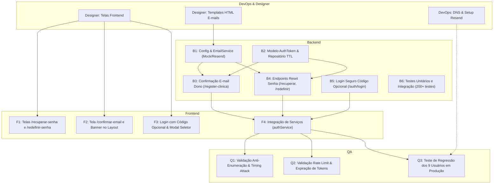

# Plano de Execução Detalhado: Fases 1 e 2
## Infraestrutura de E-mail, Recuperação de Senha e Confirmação de E-mail

> **Destinatários:** Maestro, Backend, Frontend, Designer, DevOps/Deployer, QA e Wilson  
> **Autor:** Arquiteto de Software do Bokka  
> **Data:** 22 de Outubro de 2026  
> **Versão:** 1.0.0  
> **Documento de Referência:** [`docs/plano-login-email.md`](file:///C:/Users/Wilson/Desktop/CODE/sistema-tainah/docs/plano-login-email.md)  

---

## 1. Escopo das Fases 1 e 2

Este plano operacional detalha as atividades para implementar:
- **Fase 1 (Fundação & Infraestrutura de E-mail):**
  - Integração com provedor **Resend** e configuração DNS do domínio `bokka.com.br` (SPF, DKIM, DMARC `p=none`).
  - Módulo `EmailService` no Backend com suporte a templates HTML responsivos e modo Mock/Log para desenvolvimento local.
  - Segurança de credenciais: chave da API do Resend injetada exclusivamente em tempo de execução via `-Dresend.api.key` na VPS, sem nenhum segredo no Git.
  - URL do frontend parametrizável (`app.frontend-url`), apontando para `https://bokka.com.br` em produção e `http://localhost:5173` em dev.
- **Fase 2 (Fluxos Críticos de Identidade):**
  - **Recuperação de Senha ("Esqueci minha senha"):** autoatendimento com token criptográfico de uso único (SHA-256 no Mongo), validade de 30 minutos e proteção anti-enumeração.
  - **Confirmação do E-mail do Dono:** no auto-cadastro de clínica (`POST /auth/register-clinica`), emissão de token de confirmação e banner informativo até a validação.
  - **Login Seguro com Código Opcional:** o campo de código de clínica torna-se opcional; se omitido, o sistema autentica diretamente (se e-mail for único) ou valida a senha antes de abrir o seletor de clínicas, sem jamais vazar onde a pessoa trabalha.
  - **Migração Suave dos 9 Usuários de Produção:** script idempotente marcando-os como ativos e confirmados, sem forçar troca de senha nem interromper o expediente.

---

## 2. Premissas e Decisões de Arquitetura Incorporadas

1. **Remetente Oficial:** `Bokka <notificacoes@bokka.com.br>` com `reply-to: suporte@bokka.com.br` (Opção A aprovada pelo Wilson).
2. **URL do Frontend Dinâmica:** Todas as URLs geradas nos e-mails consumirão a propriedade `${app.frontend-url}` injetada na inicialização do backend. Nunca haverá URLs absolutas hardcoded em código Java ou templates HTML.
3. **DMARC Progressivo:** Início em modo de monitoramento com política `p=none` (com envio de relatórios XML para `rua=mailto:dmarc-reports@bokka.com.br`), permitindo observar o alinhamento SPF/DKIM antes de subir para `p=quarantine`.
4. **Segurança de Credenciais do Resend:**
   - No Git / `application.properties`: `resend.api.key=${RESEND_API_KEY:}` (vazia por padrão).
   - Em desenvolvimento: se vazia, opera em **Modo Log / Mock** (imprime o e-mail completo no console sem disparar na internet e sem falhar o build/testes).
   - Na VPS de produção: passada pelo script `start-bokka.sh` via `-Dresend.api.key="$RESEND_API_KEY"`.
5. **Anti-Enumeração e Anti-Brute Force no Login com Código Opcional:**
   - Se o usuário omitir o `clinicaCodigo`, o backend pesquisa os usuários daquele e-mail.
   - **Zero vazamento:** Se encontrar 2 ou mais clínicas associadas àquele e-mail, o backend **NÃO** exibe as clínicas de imediato. Ele testa a senha contra os usuários encontrados. Se a senha casar em uma clínica, loga direto. Se casar em múltiplas (mesma senha), emite um ticket temporário assinado e abre o seletor. Se a senha estiver errada, retorna `401 Unauthorized` genérico.
   - Se o e-mail não existir, roda um hash dummy de BCrypt para igualar o tempo de resposta (mitigação de timing attack).
   - Rate limit rigoroso no login e no reset de senha.

---

## 3. O que Depende Exclusivamente do Wilson (Bloqueios Externos)

As seguintes ações dependem de credenciais ou autorizações que só o Wilson possui:

| # | Item | Ação Necessária do Wilson | Bloqueia |
| :-: | :--- | :--- | :--- |
| **W1** | **Conta Resend** | Criar a conta no [resend.com](https://resend.com), cadastrar o domínio `bokka.com.br` e fornecer a **API Key** gerada (re_...) de forma segura. | DevOps na VPS / Disparos reais |
| **W2** | **Zona DNS de `bokka.com.br`** | Inserir os registros CNAME (DKIM), TXT (SPF) e TXT (DMARC) gerados pelo Resend no painel DNS (Registro.br, Cloudflare ou provedor de hospedagem). | Validação do domínio no Resend |
| **W3** | **Caixa de E-mail `suporte@bokka.com.br`** | Garantir que o e-mail `suporte@bokka.com.br` exista como caixa real ou redirecionamento (para receber eventuais respostas de clientes). | Atendimento a respostas de e-mail |

> *Nota:* O time de desenvolvimento (Backend, Frontend, Designer e QA) pode implementar e testar **100% das Fases 1 e 2 localmente** sem esperar por W1, W2 e W3, utilizando o modo Mock/Log do serviço de e-mail.

---

## 4. Divisão de Tarefas por Agente



---

### 4.1 Agente: DevOps / Deployer

- [ ] **Tarefa D1: Configuração do Domínio no Resend e DNS**
  - **Arquivos:** Registros DNS do domínio `bokka.com.br`.
  - **Ações:**
    - Adicionar domínio `bokka.com.br` no painel do Resend.
    - Configurar registros DKIM (3 CNAMEs fornecidos pelo Resend).
    - Configurar registro SPF: TXT `@` `v=spf1 include:amazonses.com ~all` (ou conforme Resend).
    - Configurar registro DMARC: TXT `_dmarc.bokka.com.br` com valor `v=DMARC1; p=none; rua=mailto:dmarc-reports@bokka.com.br; pct=100`.
  - **Critério de Aceite:** Painel do Resend exibindo status **"Verified"** para DKIM e SPF.
- [ ] **Tarefa D2: Script de Inicialização da VPS (`start-bokka.sh`)**
  - **Arquivos:** `/opt/bokka/start-bokka.sh` (ou caminho equivalente na VPS).
  - **Ações:**
    - Exportar variável de ambiente ou injetar argumento JVM:
      ```bash
      java -Dresend.api.key="${RESEND_API_KEY}" \
           -Dapp.frontend-url="https://bokka.com.br" \
           -jar demo.jar
      ```
    - Assegurar que a chave nunca seja impressa em logs públicos.
  - **Critério de Aceite:** Backend iniciando na VPS com a chave ativa e sem segredos gravados no repositório.
- [ ] **Tarefa D3: Script de Migração dos Usuários Legados**
  - **Arquivos:** `scripts/migracao-email-confirmado.js`.
  - **Ações:** Script mongosh idempotente com dry-run para marcar os 9 usuários existentes em produção com `{ emailConfirmado: true, statusConta: "ATIVO" }`.
  - **Critério de Aceite:** Execução em staging e produção com relatório de 9 registros atualizados e 0 falhas.

---

### 4.2 Agente: Designer

- [ ] **Tarefa DS1: Templates HTML de E-mail Responsivos (Padrão Bokka)**
  - **Arquivos:** `src/main/resources/templates/email/`
    - `reset-senha.html`: E-mail de redefinição de senha com botão de ação destacado e aviso de validade de 30 minutos.
    - `confirmar-email-dono.html`: E-mail de boas-vindas e confirmação de titularidade da clínica recém-criada.
    - `senha-alterada-alerta.html`: Alerta imediato de segurança informando data/hora em que a senha foi modificada.
    - `lembrete-codigos-clinica.html`: Lista clara dos nomes e códigos das clínicas associadas ao e-mail.
  - **Diretrizes de Design:**
    - Compatibilidade rigorosa de HTML para e-mails (tabelas para layout, CSS inlined, sem scripts, imagens com caminhos absolutos HTTPS).
    - Paleta visual Bokka: container `#FFFFFF`, fundo `#F8F9FA`, botão principal `#0E9384` (arredondamento 8px), texto `#111827`, tipografia `Inter, -apple-system, sans-serif`.
    - Rodapé com identificação clara: *"Bokka · Sistema de Gestão Odontológica · Suporte: suporte@bokka.com.br"*.
  - **Critério de Aceite:** Renderização impecável validada no Gmail (web e app mobile), Apple Mail e Outlook.
- [ ] **Tarefa DS2: Especificação Visual das Novas Telas Frontend**
  - **Telas:**
    - `/recuperar-senha`: Card centralizado, BokkaMark, input de e-mail e código opcional, botão de envio, feedback de envio.
    - `/redefinir-senha`: Card com indicador de força da nova senha (fraca, média, forte) e requisitos (mínimo 6 caracteres).
    - `/confirmar-email`: Tela de confirmação com animação de sucesso e botão para entrar no painel.
    - `SeletorClinicaModal`: Modal limpo listando as clínicas onde o usuário possui acesso caso a senha case em múltiplas clínicas.
  - **Critério de Aceite:** Componentes consistentes com os tokens de design existentes em `src/components/ui/`.

---

### 4.3 Agente: Backend

- [ ] **Tarefa B1: Configuração e Módulo `EmailService`**
  - **Arquivos Prováveis:**
    - `src/main/resources/application.properties`
    - `src/main/java/com/example/demo/email/EmailService.java` (Interface)
    - `src/main/java/com/example/demo/email/ResendEmailSender.java`
    - `src/main/java/com/example/demo/email/EmailTemplateService.java`
  - **Ações:**
    - Configurar propriedades no `application.properties`:
      ```properties
      resend.api.key=${RESEND_API_KEY:}
      resend.from-email=${RESEND_FROM_EMAIL:Bokka <notificacoes@bokka.com.br>}
      resend.reply-to=${RESEND_REPLY_TO:suporte@bokka.com.br}
      app.frontend-url=${APP_FRONTEND_URL:http://localhost:5173}
      ```
    - Implementar chamada HTTP via `RestClient` do Spring Boot 4 apontando para `https://api.resend.com/emails` com timeout de 5 segundos.
    - Implementar fallback: se `resend.api.key` for vazia ou nula, registrar no log (nível INFO/WARN) o envio mockado sem lançar exceção.
    - Interpolação de templates com Thymeleaf ou substituição de tokens `${variavel}` com injeção segura de `${app.frontend-url}`.
  - **Critério de Aceite:** Testes unitários com mock e teste manual em dev imprimindo o e-mail completo no console.
- [ ] **Tarefa B2: Modelo `AuthToken` e Repositório com Índice TTL**
  - **Arquivos Prováveis:**
    - `src/main/java/com/example/demo/model/AuthToken.java`
    - `src/main/java/com/example/demo/enums/TipoTokenAuthEnum.java` (`RESET_SENHA`, `CONFIRMAR_EMAIL_DONO`, `ATIVACAO_CONTA`)
    - `src/main/java/com/example/demo/repository/AuthTokenRepository.java`
    - `src/main/java/com/example/demo/service/AuthTokenService.java`
  - **Ações:**
    - Entidade com `@Document(collection = "auth_tokens")`, `userId`, `clinicaId`, `tokenHash` (SHA-256), `tipo`, `expiraEm`, `usadoEm`.
    - Índice TTL `@Indexed(expireAfterSeconds = 0)` no campo `expiraEm`.
    - Métodos para gerar token seguro de 32 bytes (`SecureRandom`), gravar hash SHA-256 e validar token com queima imediata (*one-time use*).
  - **Critério de Aceite:** O token bruto nunca é salvo no banco; tentativa de usar o mesmo token duas vezes retorna erro.
- [ ] **Tarefa B3: Atualização do Modelo `User.java` e Cadastro de Clínica**
  - **Arquivos Prováveis:**
    - `src/main/java/com/example/demo/model/User.java`
    - `src/main/java/com/example/demo/controller/AuthController.java` (`registerClinica`, `confirmarEmail`)
  - **Ações:**
    - Adicionar campos `emailConfirmado` (Boolean, default false) e `statusConta` (`ATIVO`, `PENDENTE_ATIVACAO`, `BLOQUEADO`) em `User.java`.
    - No endpoint `POST /auth/register-clinica`:
      - Salva a clínica e o proprietário com `emailConfirmado = false`.
      - Gera token `CONFIRMAR_EMAIL_DONO` com validade de 48h.
      - Dispara e-mail de confirmação para o e-mail do dono via `EmailService`.
      - Continua retornando o JWT inicial para que o dono não seja travado no fluxo de onboarding.
    - Criar endpoint `POST /auth/confirmar-email` recebendo `{ token }`:
      - Valida o token, marca `user.setEmailConfirmado(true)` e invalida o token.
  - **Critério de Aceite:** Cadastro de clínica dispara o e-mail; link de confirmação altera o status para confirmado.
- [ ] **Tarefa B4: Endpoints de Recuperação de Senha**
  - **Arquivos Prováveis:**
    - `src/main/java/com/example/demo/controller/AuthController.java`
    - `src/main/java/com/example/demo/dto/RecuperarSenhaDTO.java`
    - `src/main/java/com/example/demo/dto/RedefinirSenhaDTO.java`
  - **Ações:**
    - `POST /auth/recuperar-senha` (público):
      - Recebe `{ email, clinicaCodigo? }`.
      - Rate limit: máximo de 3 pedidos por IP/e-mail a cada 15 min.
      - Sempre responde `HTTP 200 { mensagem: "Se os dados informados estiverem corretos, enviamos as instruções para o seu e-mail." }`.
      - Se e-mail/clínica baterem: gera token `RESET_SENHA` (30 min) e envia e-mail com link `${app.frontend-url}/redefinir-senha?token=XYZ&c=${clinicaCodigo}`.
    - `POST /auth/validar-token` (público):
      - Recebe `{ token, tipo }`.
      - Valida se existe e não expirou, devolvendo `{ valido: true, clinicaNome: "...", clinicaCodigo: "..." }`.
    - `POST /auth/redefinir-senha` (público):
      - Recebe `{ token, novaSenha }`.
      - Valida força da senha (mínimo 6 caracteres).
      - Grava nova senha com BCrypt, marca token como usado, dispara e-mail de alerta de segurança e retorna `200 OK`.
  - **Critério de Aceite:** Fluxo completo ponta a ponta funcional, com resposta neutra para e-mails inexistentes.
- [ ] **Tarefa B5: Login Seguro com Código Opcional e Anti-Enumeração**
  - **Arquivos Prováveis:**
    - `src/main/java/com/example/demo/controller/AuthController.java` (`login`, `selecionarClinica`)
    - `src/main/java/com/example/demo/service/UserLookupService.java`
  - **Ações:**
    - Tornar `clinicaCodigo` opcional em `LoginRequestDTO`.
    - Se `clinicaCodigo` fornecido: mantém o fluxo multi-tenant atual idêntico.
    - Se `clinicaCodigo` omitido:
      1. Busca usuários com aquele e-mail em todas as clínicas via `UserLookupService`.
      2. Se 0 usuários: executa `new BCryptPasswordEncoder().matches("dummy", "$2a$10$dummyHash...")` para igualar latência e retorna `401 Unauthorized ("Credenciais inválidas")`.
      3. Se 1 usuário: compara a senha com BCrypt. Se casar, emite o JWT. Se não casar, retorna `401`.
      4. Se 2+ usuários: testa a senha com BCrypt em cada um.
         - Se casar em exatamente 1 clínica: emite JWT imediatamente (zero atrito!).
         - Se casar em mais de 1 clínica: gera ticket temporário assinado (validade 5 min) e retorna `200 OK` com `{ status: "SELECAO_CLINICA", ticket: "...", clinicas: [ { id, codigo, nome } ] }`.
         - Se não casar em nenhuma: retorna `401 Unauthorized`.
    - Endpoint `POST /auth/login/selecionar-clinica`: recebe `{ ticket, clinicaId }`, valida e emite o JWT definitivo.
  - **Critério de Aceite:** Impossível descobrir se um e-mail existe sem acertar a senha.
- [ ] **Tarefa B6: Suíte de Testes Automatizados**
  - **Arquivos Prováveis:**
    - `src/test/java/com/example/demo/email/EmailServiceTest.java`
    - `src/test/java/com/example/demo/service/AuthTokenServiceTest.java`
    - `src/test/java/com/example/demo/controller/RecuperacaoSenhaTest.java`
    - `src/test/java/com/example/demo/controller/LoginSeguroTest.java`
  - **Ações:** Cobrir todos os novos endpoints com testes unitários e de integração mockando o `EmailService`.
  - **Critério de Aceite:** Suíte Maven com 200+ testes passando sem quebras.

---

### 4.4 Agente: Frontend

- [ ] **Tarefa F1: Telas de Recuperação e Redefinição de Senha**
  - **Arquivos Prováveis:**
    - `src/pages/RecuperarSenha.tsx` (Nova tela)
    - `src/pages/RedefinirSenha.tsx` (Nova tela)
    - `src/App.tsx` (Configuração de rotas)
  - **Ações:**
    - Criar rota `/recuperar-senha`: campo de e-mail e campo de código da clínica (opcional, com memória do `localStorage`), botão de submissão e mensagem de sucesso instruindo checar caixa de entrada e spam.
    - Criar rota `/redefinir-senha`: lê `token` e `c` da URL, chama `/auth/validar-token` no carregamento. Se inválido/expirado, exibe aviso com link para nova solicitação. Se válido, exibe campos de nova senha e confirmação com barra de força visual.
  - **Critério de Aceite:** Navegação fluida, formulários com estados de loading e erro via design Bokka.
- [ ] **Tarefa F2: Tela de Confirmação de E-mail e Banner de Aviso**
  - **Arquivos Prováveis:**
    - `src/pages/ConfirmarEmail.tsx` (Nova tela)
    - `src/components/AppLayout.tsx`
  - **Ações:**
    - Criar rota `/confirmar-email`: consome o token de confirmação e exibe mensagem de sucesso com botão *"Acessar meu painel"*.
    - Em `AppLayout.tsx`: se o usuário logado for `PROPRIETARIO` e tiver `emailConfirmado: false`, exibir banner sutil no topo do painel:  
      *"Seu e-mail ainda não foi confirmado. Enviamos um link de confirmação para [email]. [Reenviar confirmação]"*.
  - **Critério de Aceite:** Banner não intrusivo e confirmação ponta a ponta funcional.
- [ ] **Tarefa F3: Login com Código Opcional e Modal Seletor de Clínica**
  - **Arquivos Prováveis:**
    - `src/pages/Login.tsx`
    - `src/components/SeletorClinicaModal.tsx` (Novo componente)
  - **Ações:**
    - Em `Login.tsx`: remover a obrigatoriedade visual do campo "Código da clínica" (mantendo-o visível com o valor salvo no `localStorage`).
    - Adicionar link *"Esqueci minha senha"*.
    - Ao submeter o login: se o backend responder `{ status: "SELECAO_CLINICA" }`, abrir `SeletorClinicaModal`. Ao clicar na clínica desejada, enviar a seleção e concluir o login.
  - **Critério de Aceite:** Usuário com uma clínica entra direto sem digitar o código se não quiser; usuário multi-clínica escolhe no modal após acertar a senha.
- [ ] **Tarefa F4: Service de Autenticação (`authService.ts`)**
  - **Arquivos Prováveis:**
    - `src/services/authService.ts`
    - `src/types/index.ts`
  - **Ações:** Adicionar métodos tipados para `recuperarSenha`, `validarToken`, `redefinirSenha`, `confirmarEmail` e `selecionarClinica`.
  - **Critério de Aceite:** Build do frontend (`tsc -b && vite build`) concluído com 0 erros de tipagem.

---

### 4.5 Agente: QA (Garantia de Qualidade & Segurança)

- [ ] **Tarefa Q1: Testes de Invasão e Anti-Enumeração**
  - **Ações:**
    - Testar endpoint `/auth/recuperar-senha` com e-mails válidos e inválidos: a resposta, o status HTTP (200) e o tempo de resposta devem ser indistinguíveis.
    - Testar login sem código com senha errada: garantir que nenhuma informação sobre clínicas associadas seja exposta.
  - **Critério de Aceite:** Zero vazamento de dados de clínicas para usuários não autenticados.
- [ ] **Tarefa Q2: Teste de Ciclo de Vida e Expiração de Tokens**
  - **Ações:**
    - Tentar reutilizar um token já consumido (deve ser rejeitado com 400).
    - Simular token com data de expiração passada (deve ser rejeitado como expirado).
    - Testar rate limit: disparar 10 requisições consecutivas de recuperação de senha e verificar se o limitador bloqueia a partir da 4ª chamada.
  - **Critério de Aceite:** Tokens de uso único estrito e proteção contra abusos validada.
- [ ] **Tarefa Q3: Teste de Regressão em Produção (9 Usuários)**
  - **Ações:**
    - Validar que as contas existentes em produção conseguem realizar login normalmente com código da clínica e suas senhas atuais.
  - **Critério de Aceite:** Nenhuma interrupção operacional para os usuários existentes.

---

## 5. Ordem de Execução e Dependências

A execução deve seguir rigorosamente a sequência abaixo para evitar retrabalho e bloqueios entre agentes:

```
PASSO 1 (Paralelo):
├── [Designer] DS1: Criar templates HTML de e-mail
├── [Designer] DS2: Mockups e especificação das telas
└── [DevOps]   D1: Criar conta Resend e iniciar validação DNS (com Wilson)

PASSO 2 (Backend Core):
├── [Backend]  B1: Implementar EmailService + Mock local + Application Properties
└── [Backend]  B2: Criar modelo AuthToken e repositório com TTL

PASSO 3 (Backend Endpoints):
├── [Backend]  B3: Confirmação de e-mail do dono no cadastro de clínica
├── [Backend]  B4: Endpoints de recuperação e redefinição de senha
└── [Backend]  B5: Login com código opcional e anti-enumeração

PASSO 4 (Frontend Core):
├── [Frontend] F4: Atualizar authService.ts e types
├── [Frontend] F1: Telas /recuperar-senha e /redefinir-senha
├── [Frontend] F2: Tela /confirmar-email e Banner no layout
└── [Frontend] F3: Ajustar Login.tsx e criar SeletorClinicaModal

PASSO 5 (Validação e QA):
├── [Backend]  B6: Execução de 200+ testes unitários e de integração
├── [QA]       Q1: Testes de anti-enumeração e timing attack
├── [QA]       Q2: Teste de rate limit e expiração de tokens
└── [DevOps]   D3: Rodar script de migração dos 9 usuários em staging

PASSO 6 (Deploy de Produção):
├── [DevOps]   D2: Atualizar start-bokka.sh na VPS com RESEND_API_KEY
├── [Deploy]   Deploy Backend e Frontend em produção
└── [QA]       Q3: Teste de fumaça de login dos 9 usuários reais
```

---

## 6. Arquivos Prováveis Afetados

### Backend (`demo/`)
- `pom.xml`
- `src/main/resources/application.properties`
- `src/main/resources/templates/email/reset-senha.html` *(Novo)*
- `src/main/resources/templates/email/confirmar-email-dono.html` *(Novo)*
- `src/main/resources/templates/email/senha-alterada-alerta.html` *(Novo)*
- `src/main/java/com/example/demo/model/User.java`
- `src/main/java/com/example/demo/model/AuthToken.java` *(Novo)*
- `src/main/java/com/example/demo/enums/TipoTokenAuthEnum.java` *(Novo)*
- `src/main/java/com/example/demo/repository/AuthTokenRepository.java` *(Novo)*
- `src/main/java/com/example/demo/service/AuthTokenService.java` *(Novo)*
- `src/main/java/com/example/demo/email/EmailService.java` *(Novo)*
- `src/main/java/com/example/demo/email/ResendEmailSender.java` *(Novo)*
- `src/main/java/com/example/demo/email/EmailTemplateService.java` *(Novo)*
- `src/main/java/com/example/demo/controller/AuthController.java`
- `src/main/java/com/example/demo/dto/LoginRequestDTO.java`
- `src/main/java/com/example/demo/dto/RecuperarSenhaDTO.java` *(Novo)*
- `src/main/java/com/example/demo/dto/RedefinirSenhaDTO.java` *(Novo)*
- `scripts/migracao-email-confirmado.js` *(Novo)*

### Frontend (`odonto-clinic-web/`)
- `src/App.tsx`
- `src/types/index.ts`
- `src/services/authService.ts`
- `src/pages/Login.tsx`
- `src/pages/RecuperarSenha.tsx` *(Novo)*
- `src/pages/RedefinirSenha.tsx` *(Novo)*
- `src/pages/ConfirmarEmail.tsx` *(Novo)*
- `src/components/SeletorClinicaModal.tsx` *(Novo)*
- `src/components/AppLayout.tsx`

---

*Documento técnico gravado em [`docs/plano-execucao-fase-1-2.md`](file:///C:/Users/Wilson/Desktop/CODE/sistema-tainah/docs/plano-execucao-fase-1-2.md).*
