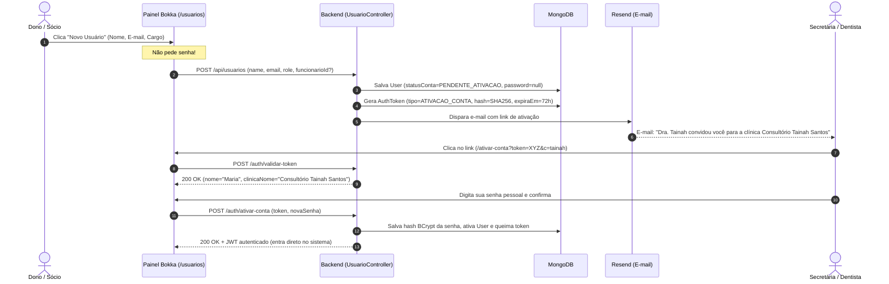

# Plano de Arquitetura: Autenticação com Código de Clínica, E-mails Reais e Transacionais no Bokka

> **Status:** Aprovado e Alinhado com a Visão do Produto (Diretriz do Wilson)  
> **Autor:** Arquiteto de Software do Bokka  
> **Data:** 22 de Outubro de 2026  
> **Versão:** 2.0.0 (Revisada com Manutenção do Código da Clínica)  

---

## 1. Resumo Executivo e Visão de Produto

O modelo de negócio do **Bokka** atende donos de consultórios odontológicos e proprietários de clínicas. Para esse perfil, o **Código da Clínica (`clinicaCodigo`) é um pilar de identidade, soberania e isolamento multi-tenant**.

Conforme diretriz estrita do Wilson, **o código da clínica continuará existindo e sendo obrigatório no login de cada clínica cadastrada**.

Com essa premissa como base arquitetural, a evolução para **e-mails reais e comunicação transacional** traz:
1. **Fim da senha inventada pelo administrador:** Quando um dono ou sócio cadastra uma secretária, auxiliar ou dentista, ele **não inventa nem digita a senha** da pessoa. O sistema dispara um **convite por e-mail** com link seguro para o colaborador definir sua própria senha no primeiro acesso.
2. **Autoatendimento com Recuperação de Senha ("Esqueci minha senha"):** O usuário informa o código da clínica e seu e-mail, recebendo um link seguro de redefinição com validade curta e token de uso único.
3. **Logins associados a e-mails reais e confirmados:** Cada usuário (proprietário, sócio, dentista, funcionário) possui seu e-mail real validado para segurança e auditoria.
4. **Infraestrutura Transacional no domínio `bokka.com.br`:** Configuração no **Resend** com autenticação rigorosa SPF, DKIM e DMARC a custo zero na fase atual.
5. **Continuidade total para os 9 usuários existentes:** Zero impacto e zero bloqueio no deploy; todo mundo que já tem senha continua entrando normalmente.

---

## 2. Diagnóstico do Estado Atual

### 2.1 Backend (`demo/`)
- **Login (`POST /auth/login`):**
  - Recebe `{ clinicaCodigo, email, password }`.
  - Valida a `Clinica` ativa por `codigo` (ex.: `"tainah"`).
  - Valida o `User` por `email` dentro daquela clínica através de `UserLookupService`.
  - Valida a senha criptografada via BCrypt.
  - Emite JWT de 24h contendo claims: `sub: user.getEmail()`, `userId`, `clinicaId`, `clinicaCodigo`, `role`, `permissoes`.
- **Modelagem `User.java`:**
  - `@CompoundIndex(name = "email_clinica_unique", def = "{'email': 1, 'clinicaId': 1}", unique = true)`.
  - O e-mail é único **dentro de cada clínica**. O mesmo profissional (ex.: uma secretária ou dentista que atende no consultório da Dra. Tainah e na clínica do Dr. Wilson) pode usar seu e-mail pessoal em ambos os locais, com senhas e papéis independentes sob o respectivo código de clínica.
  - **Falta hoje:** Campos de confirmação de e-mail (`emailConfirmado`), status de ativação (`statusConta`), tokens de reset e envio de e-mails transacionais.
- **Processo Atual de Cadastro de Equipe:**
  - `Funcionario` e `Dentista` são apenas fichas cadastrais (`/funcionarios`, `/dentistas`).
  - Para liberar login, o administrador acessa `/usuarios` e preenche `POST /api/usuarios` **digitando manualmente uma senha provisória**.
  - O administrador transmite a senha verbalmente ou por WhatsApp, o que gera vulnerabilidade de segurança e retrabalho constante.

### 2.2 Frontend (`odonto-clinic-web/`)
- **Tela de Login (`src/pages/Login.tsx`):**
  - Possui os campos "Código da clínica", "E-mail" e "Senha".
  - Salva o último código da clínica no `localStorage` (`bokka:lastClinicaCodigo`), facilitando o acesso diário sem precisar redigitar.
  - Não possui opção de "Esqueci minha senha".

---

## 3. Provedor de E-mail: Recomendação pelo Resend

Para um SaaS no Brasil enviando e-mails transacionais a partir do domínio `bokka.com.br`:

### 3.1 Comparativo

| Critério | **Resend** (Recomendado) | **Postmark** | **Amazon SES** | **Brevo (Sendinblue)** |
| :--- | :--- | :--- | :--- | :--- |
| **Foco** | Transacional moderno para devs | Transacional premium | Infraestrutura bruta | Marketing + CRM |
| **Entregabilidade Brasil** | **Excelente** (Infraestrutura AWS monitorada contra spam) | **Excepcional** | Variável (IPs compartilhados baratos sofrem em Outlook/Terra) | Moderada (mistura listas de marketing) |
| **Plano Gratuito** | **3.000 e-mails/mês** (100/dia) | 100 e-mails (teste único) | 3.000/mês (somente no EC2) | 300/dia (com branding Brevo) |
| **Custo ao Escalar** | **US$ 20/mês** (50.000 e-mails) | US$ 15/mês (10.000 e-mails) | US$ 0,10/mil (+ IP dedicado opcional) | US$ 9 a 25/mês |
| **Setup DNS** | Visual, DKIM/SPF/DMARC automático | Detalhado | Técnico (Route53/SES/SNS) | Padrão |
| **Complexidade em Java** | SDK oficial (`resend-java`) ou REST via `RestClient` do Spring Boot 4 | API REST | AWS SDK v2 (pesado) | SDK OpenAPI |

### 3.2 Recomendação: **Resend**
- Cobre 100% da necessidade do Bokka com custo zero na fase atual.
- Setup DNS em minutos no `bokka.com.br` com suporte total a SPF, DKIM e DMARC.
- Remetente oficial padronizado: `Bokka <notificacoes@bokka.com.br>` com `reply-to: suporte@bokka.com.br`.

---

## 4. Desenho dos Fluxos de Autenticação com Código de Clínica

### 4.1 Login Diário (Preservado e Aprimorado)
O login do Bokka permanece fundamentado na tríade:
`Código da Clínica` + `E-mail` + `Senha`.

```
+-------------------------------------------------------------+
|                        Entrar no Bokka                      |
|                                                             |
|  Código da clínica: [ tainah                             ]  |
|  (Lembrado automaticamente no navegador)                    |
|                                                             |
|  E-mail:            [ secretaria@gmail.com               ]  |
|  Senha:             [ ••••••••••                         ]  |
|                                                             |
|  [                      Entrar                           ]  |
|                                                             |
|  Esqueci minha senha · Esqueci o código da clínica          |
+-------------------------------------------------------------+
```

- **Agilidade:** O `localStorage` (`bokka:lastClinicaCodigo`) já mantém o código salvo. Para quem usa o computador do consultório todo dia, o código já vem preenchido!
- **Link com código na URL:** Clínicas podem salvar nos favoritos: `app.bokka.com.br/login?c=tainah`. Ao abrir, o código já vem fixado e o foco vai direto para o e-mail!

---

### 4.2 Fluxo de Ativação por Convite (Novo Membro da Equipe)

O dono ou sócio cadastra o membro da equipe sem precisar inventar senha:



#### Vantagens:
- A senha é de conhecimento exclusivo do colaborador.
- O e-mail do colaborador é automaticamente comprovado como real no momento da ativação.
- Se o colaborador demorar mais de 72h, o administrador tem o botão **"Reenviar Convite"** na tela `/usuarios`.

---

### 4.3 Fluxo de Recuperação de Senha ("Esqueci Minha Senha")

1. **Solicitação:**
   - Na tela de login, o usuário clica em **"Esqueci minha senha"**.
   - A tela `/recuperar-senha` pede:
     - **Código da clínica** (já preenchido automaticamente se veio da tela de login).
     - **E-mail cadastrado**.
2. **Segurança Anti-Enumeração no Backend:**
   - O backend sempre retorna `HTTP 200 OK`:  
     *"Se os dados informados estiverem corretos, enviamos as instruções de recuperação para o seu e-mail."*
   - O invasor não descobre se o e-mail ou código de clínica existem.
3. **Geração do Token e Disparo:**
   - Localiza a clínica e o usuário correspondente.
   - Gera token seguro (256 bits, `SecureRandom`), gravando apenas o hash SHA-256 em `auth_tokens` com validade de **30 minutos**.
   - Dispara e-mail:  
     - **Assunto:** `Recuperação de senha - Consultório Tainah Santos (Bokka)`
     - **Link:** `https://app.bokka.com.br/redefinir-senha?token=XYZ&c=tainah`
4. **Redefinição:**
   - O usuário acessa a tela `/redefinir-senha`, digita a nova senha e clica em **"Salvar nova senha"**.
   - O token é consumido (`usadoEm = now`) e um e-mail de alerta de segurança é disparado informando a alteração.

---

### 4.4 Esqueci o Código da Minha Clínica (Recurso Adicional de Apoio)

Para evitar chamados no suporte de colaboradores que esqueceram o código da clínica onde trabalham:
- Na tela de login, há o link discreto: *"Esqueceu o código da clínica?"*.
- O usuário digita apenas seu e-mail.
- O backend consulta as clínicas associadas àquele e-mail e dispara:  
  *"Olá! Você possui cadastro no Bokka nas seguintes clínicas:  
  • Consultório Dra. Tainah Santos — Código da clínica: `tainah`  
  Acesse em: app.bokka.com.br/login?c=tainah"*
- Resposta pública sempre neutra (anti-enumeração).

---

## 5. Estratégia de Migração para os 9 Usuários em Produção

A migração é **invisível e sem travamentos**:
1. **Preservação de Senhas:** Nenhuma senha existente é alterada ou invalidada.
2. **Script de Atualização de Schema:**
   - Executado via script `mongosh` seguro em produção:
     ```javascript
     db.users.updateMany(
       { emailConfirmado: { $exists: false } },
       { 
         $set: { 
           emailConfirmado: true,
           statusConta: "ATIVO",
           migracaoLegada: true,
           updatedAt: new Date()
         } 
       }
     );
     ```
3. **Comportamento no Deploy:**
   - Na manhã seguinte ao deploy, todos os 9 usuários continuam digitando o código da clínica, seu e-mail e sua senha de sempre. **Ninguém é desconectado ou impedido de trabalhar.**
   - Se o e-mail cadastrado for fictício (ex.: `admin@multiclinica.com`), o dono pode simplesmente atualizá-lo na página de perfil ou na tela de usuários quando desejar.

---

## 6. Modelo de Dados e Endpoints de Backend

### 6.1 Ajuste em `User.java`
```java
@Builder.Default
private Boolean emailConfirmado = false;

@Builder.Default
private StatusContaEnum statusConta = StatusContaEnum.ATIVO; // PENDENTE_ATIVACAO, ATIVO, BLOQUEADO

private LocalDateTime emailConfirmadoEm;
private LocalDateTime ultimoLoginEm;
```

### 6.2 Nova Coleção `auth_tokens`
```java
@Data
@Builder
@NoArgsConstructor
@AllArgsConstructor
@Document(collection = "auth_tokens")
public class AuthToken {

    @Id
    private String id;

    @Indexed
    private String userId;

    @Indexed
    private String clinicaId;

    /** Hash SHA-256 do token (o token original nunca fica salvo no banco). */
    @Indexed(unique = true)
    private String tokenHash;

    private TipoTokenAuthEnum tipo; // ATIVACAO_CONTA, RESET_SENHA, LEMBRETE_CLINICA

    /** Índice TTL do MongoDB: documento deletado automaticamente após expirar. */
    @Indexed(expireAfterSeconds = 0)
    private LocalDateTime expiraEm;

    private LocalDateTime usadoEm;
    private LocalDateTime criadoEm;
    private String ipSolicitacao;
}
```

### 6.3 Novos Endpoints em `AuthController.java`

1. `POST /auth/login` (Mantido 100% compatível):
   - Payload: `{ clinicaCodigo, email, password }`
   - Valida se `statusConta != BLOQUEADO`. Se `PENDENTE_ATIVACAO`, retorna mensagem orientando verificar o convite por e-mail.
2. `POST /auth/recuperar-senha`:
   - Payload: `{ clinicaCodigo, email }`
   - Resposta: `HTTP 200 { mensagem: "Se os dados estiverem corretos, enviamos as instruções." }`.
3. `POST /auth/esqueci-codigo-clinica`:
   - Payload: `{ email }`
   - Envia e-mail listando os códigos das clínicas em que aquele e-mail está cadastrado.
4. `POST /auth/validar-token`:
   - Payload: `{ token, tipo }`
   - Valida antes de carregar o formulário no front, retornando `{ valido: true, nome: "Maria", clinicaNome: "Consultório Tainah Santos", clinicaCodigo: "tainah" }`.
5. `POST /auth/redefinir-senha`:
   - Payload: `{ token, novaSenha }`
   - Salva a senha em BCrypt e queima o token.
6. `POST /auth/ativar-conta`:
   - Payload: `{ token, senha }`
   - Salva a senha inicial, marca `emailConfirmado = true`, `statusConta = ATIVO` e retorna JWT para login imediato.
7. `POST /api/usuarios/{id}/reenviar-convite` (Autenticado):
   - Permite ao dono reenviar o convite caso o colaborador não tenha ativado em 72h.

---

## 7. Telas e Mudanças no Frontend (`odonto-clinic-web/`)

1. **`src/pages/Login.tsx`:**
   - Mantém os 3 campos: **Código da clínica**, **E-mail** e **Senha**.
   - Adiciona os links discretos abaixo do botão:
     - *"Esqueci minha senha"*
     - *"Esqueci o código da clínica"*
   - Suporte a query param na URL (`/login?c=tainah`), preenchendo automaticamente o código.
2. **`src/pages/RecuperarSenha.tsx` (Nova tela):**
   - Inputs: Código da clínica (pré-carregado se veio do login) e E-mail.
   - Botão: *"Enviar link de recuperação"*.
   - Mensagem de sucesso amigável.
3. **`src/pages/RedefinirSenha.tsx` (Nova tela):**
   - Rota `/redefinir-senha?token=...&c=tainah`.
   - Exibe nome da clínica no topo e inputs de nova senha com medidor de força.
4. **`src/pages/AtivarConta.tsx` (Nova tela):**
   - Rota `/ativar-conta?token=...&c=tainah`.
   - Mensagem de boas-vindas: *"Dra. Tainah convidou você para a equipe Consultório Tainah Santos no Bokka."*
   - Definição da primeira senha e entrada imediata.
5. **`src/pages/Usuarios.tsx` (Gestão de Usuários):**
   - Modal de criação de usuário: **remove o campo obrigatório de senha**.
   - Adiciona o aviso: *"O colaborador receberá um convite por e-mail para cadastrar sua própria senha."*
   - Tabela de usuários: badge de status (`Ativo`, `Pendente de Ativação`, `Inativo`) e botão de ação *"Reenviar convite"*.

---

## 8. Templates de E-mail (Padrão Bokka com Identificação da Clínica)

Todos os e-mails transacionais valorizam a marca do Bokka e o nome do consultório/clínica do cliente:

- **E-mail de Convite:**
  - **Assunto:** `Convite para acessar Consultório Tainah Santos no Bokka`
  - **Destaque:** *"Olá, [Nome]! Você foi convidado(a) por [Nome do Dono] para acessar o sistema da clínica Consultório Tainah Santos (código: `tainah`)."*
  - **Botão:** *"Definir minha senha e ativar conta"* (Válido por 72h).
- **E-mail de Recuperação de Senha:**
  - **Assunto:** `Recuperação de senha - Consultório Tainah Santos (Bokka)`
  - **Destaque:** *"Recebemos uma solicitação para redefinir a senha do seu usuário na clínica Consultório Tainah Santos."*
  - **Botão:** *"Redefinir minha senha"* (Válido por 30 minutos).
- **E-mail de Lembrete de Código da Clínica:**
  - **Assunto:** `Seus códigos de clínica no Bokka`
  - **Lista:** Relação dos códigos das clínicas onde o e-mail possui cadastro ativo.

---

## 9. Fases de Execução

1. **Fase 1: Provedor Resend & Domínio `bokka.com.br`**
   - Criação da conta Resend e validação dos registros CNAME (DKIM), TXT (SPF) e DMARC no domínio oficial.
   - Criação do serviço `EmailService` no backend.
2. **Fase 2: Recuperação de Senha ("Esqueci minha senha")**
   - Criação da coleção `auth_tokens` com índice TTL no MongoDB.
   - Endpoints de recuperação e validação de token.
   - Telas `/recuperar-senha` e `/redefinir-senha` no front.
3. **Fase 3: Convite e Ativação de Novos Membros**
   - Criação de usuários com status `PENDENTE_ATIVACAO` na tela `/usuarios`.
   - Tela `/ativar-conta` e disparo de e-mails de convite.
4. **Fase 4: Migração Suave em Produção**
   - Execução do script nos 9 usuários em produção marcando `emailConfirmado = true`.
   - Deploy das novas telas e funcionalidades sem qualquer impacto para quem já está logado.

---

## 10. Decisões Consolidadas

| Item | Decisão Aprovada |
| :--- | :--- |
| **Código da Clínica no Login** | **MANTIDO e OBRIGATÓRIO.** Cada dono de clínica tem sua soberania, e o login permanece `clinicaCodigo + email + senha`. |
| **Provedor de E-mail** | **Resend.** Melhor DX, entregabilidade robusta e tier gratuito de 3.000 e-mails/mês a custo zero. |
| **Remetente Oficial** | `Bokka <notificacoes@bokka.com.br>` com `reply-to: suporte@bokka.com.br`. |
| **Migração dos 9 Usuários Atuais** | **Fricção Zero.** Todos continuam entrando com suas senhas normais sem bloqueios. |
| **Criação de Usuários de Equipe** | **Convite por E-mail.** O dono informa o e-mail da secretária/dentista e o sistema cuida do primeiro acesso. |

---

*Documento revisado e atualizado em [`docs/plano-login-email.md`](file:///C:/Users/Wilson/Desktop/CODE/sistema-tainah/docs/plano-login-email.md).*
